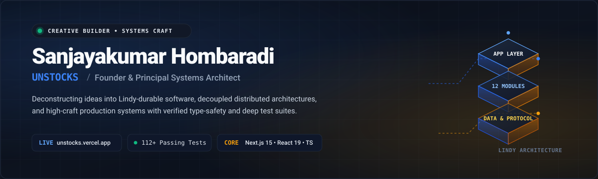
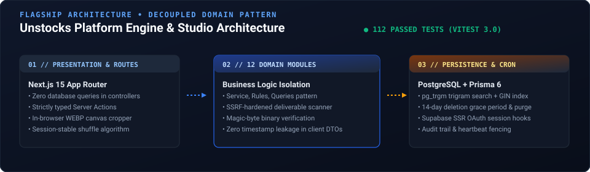
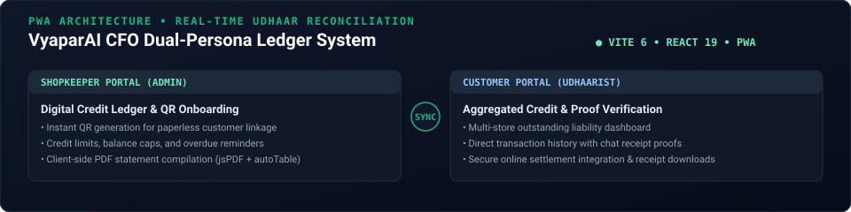
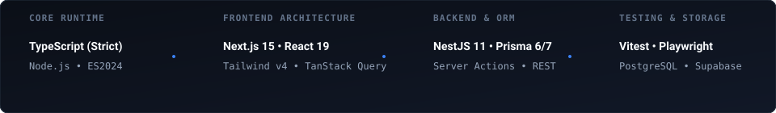

<div align="center">
  
</div>

<br/>

<div align="center">

[](https://unstocks.vercel.app)
[](https://github.com/Unstocks/clg-os)
[-10B981?style=flat-square&logo=vitest&logoColor=white)](https://github.com/Unstocks/unstocks-app)
[](https://github.com/Unstocks)
[](https://github.com/Unstocks/unstocks-app)

</div>

---

### 🏛️ The Architectural Manifesto

Most software ideas sound great on paper, but very few make it to reality. Many are just basic concepts or wrappers around existing tools that break when those tools change.

I believe in building software that lasts — from bare-metal operating system kernels up to decoupled cloud platforms. Reliable technology, modular code, verifiable hardware interfaces, and proper testing: not just something that works today, but something that keeps working tomorrow.

```
Identity      :: Sanjayakumar Hombaradi
Handle        :: @Unstocks
Role          :: Founder & Principal Systems Architect
Focus         :: Decoupled Distributed Architectures • 16-Bit Systems Programming • Local-First Systems • Execution Blueprints
Core Stack    :: TypeScript (Strict) • Next.js 15 • x86 Real-Mode Assembly • C (gcc -m16) • NestJS 11 • PostgreSQL
Live Flagship :: https://unstocks.vercel.app
Systems Lab   :: https://github.com/Unstocks/clg-os
```

---

## ⚡ Featured Engineering Systems

### 1. Unstocks Platform — Curated Digital Studio & Execution Engine
> **"Un-stock best ideas from your mind-stock."**  
> An open launchpad and execution studio designed to turn architectural ideas into production-ready software deliverables.

<p align="center">
  
</p>

* **Production URL:** [https://unstocks.vercel.app](https://unstocks.vercel.app)
* **Codebase Repository:** [`Unstocks/unstocks-app`](https://github.com/Unstocks/unstocks-app)
* **Stack:** Next.js 15.2 (App Router), React 19, TypeScript 5.8, Prisma 6.4, Supabase (PostgreSQL), Vitest 3.0, Tailwind CSS.
* **Key Architectural Primitives:**
  * **12 Decoupled Modules:** Strict domain isolation (`feed`, `ideas`, `marketplace`, `moderation`, `accounts`, `auth`, `suggestions`, etc.) ensuring route handlers perform zero database queries directly.
  * **Zero Timestamp Leakage:** Server DTO mappers omit raw timestamps and search indices to keep idea blueprints timeless and cache-friendly.
  * **Automated Security & Deliverable Inspection:** SSRF-hardened scanners, magic-byte binary validation, and sandboxed PDF inspection with **112+ passing automated Vitest tests**.
  * **Session-Stable Feed Shuffle:** Custom pseudo-random shuffle algorithm maintaining stable pagination order per session while preventing stale feed fatigue.
  * **In-Browser WEBP Canvas Cropper:** Client-side 16:9 canvas crop pipeline eliminating cloud image-processing costs.

---

### 2. GMU OS 0.1 — 16-Bit Real-Mode Operating System & C Runtime
> A bare-metal x86 educational operating system bridging assembly kernel internals with a freestanding C application environment, custom CLI shell, BIOS hardware interfaces, and FAT12 floppy-disk support.

* **Codebase Repository:** [`Unstocks/clg-os`](https://github.com/Unstocks/clg-os)
* **Stack:** 16-Bit x86 Real-Mode Assembly (NASM), Freestanding C (`gcc -m16`), GNU LD (`elf_i386`), FAT12 Filesystem, BIOS Interrupts (`INT 10h/12h/13h/16h/1Ah`), QEMU.
* **Key Architectural Primitives:**
  * **Freestanding 16-Bit C Runtime:** Custom GNU LD linker script (`gmu16.ld`) and zero-overhead inline assembly ABI bridge (`gmuos.h`) mapping C execution to kernel jump-table vectors at `0x8000` without hosted C libraries.
  * **Direct FAT12 Root Traversal:** Single-burst 14-sector root-directory parser (`DIR`) reading sectors 19–32 into RAM (`0x6000`), filtering deleted/volume/LFN entries with balanced 2-column teletype geometry (61-col max width).
  * **BSS Initialization & Overflow Protection:** Manual BSS zeroing preventing real-mode loader RAM contamination, paired with 32-bit integer arithmetic and pre-multiplication input validation in C.
  * **Modular Scientific Math Engine:** 7th-order Taylor series trigonometry (`sin`, `cos`, `tan`, `sec`, `cosec`, `cot`) with exact radical and fraction output representation for standard angles.
  * **Full Hardware Telemetry:** Direct BIOS and CMOS queries for conventional RAM (`INT 12h`), real-time clock, calendar date, and CPU segment registers (`CS`, `DS`, `SS`).

---

### 3. VyaparAI CFO — PWA for Indian Informal Credit (Udhaar)
> A specialized Progressive Web App built for Indian local shopkeepers and credit customers to digitize informal ledgers with cryptographic verification.

<p align="center">
  
</p>

* **Codebase Repository:** [`Unstocks/Vyapar-AI-CFO`](https://github.com/Unstocks/Vyapar-AI-CFO)
* **Stack:** Vite 6, React 19, TypeScript 5.6, Tailwind CSS v4, Zustand 5, jsPDF + AutoTable, Supabase (PostgreSQL triggers).
* **Key Architectural Primitives:**
  * **Dual-Persona Architecture:** Dedicated administrative ledger workflows for shopkeepers paired with an aggregated multi-store debt dashboard for customers.
  * **Paperless QR Onboarding:** Instant bidirectional store-customer linking via client-rendered QR codes without manual phone contact exchange.
  * **Client-Side PDF Generation:** Instant compilation of audit-ready transaction statements and receipts directly in browser memory via `jsPDF`, operating seamlessly offline.
  * **Real-Time Settlement Ledger:** Synchronized credit balances and dispute-proof chat records powered by Supabase real-time subscriptions and PL/pgSQL database functions.

---

## 🛠️ Verified Technology Ecosystem

<p align="center">
  
</p>

```
┌───────────────────────────┬───────────────────────────┬───────────────────────────┐
│ Runtime & Core Languages  │ Frontend & Presentation   │ Systems, Storage & Kernel │
├───────────────────────────┼───────────────────────────┼───────────────────────────┤
│ • TypeScript (Strict)     │ • Next.js 15 (App Router) │ • x86 Real-Mode (16-Bit)  │
│ • 16-Bit x86 ASM (NASM)   │ • React 19 (Server Comp.) │ • FAT12 Floppy Filesystem │
│ • C (Freestanding gcc -m16)│ • Tailwind CSS (v3 / v4)  │ • BIOS Hardware Ints      │
│ • Node.js (ES2024)        │ • TanStack Query v5       │ • NestJS 11 & Prisma ORM  │
│ • SQL & PL/pgSQL          │ • Framer Motion           │ • PostgreSQL (Supabase)   │
│ • Web APIs (Canvas, PWA)  │ • QEMU PC Emulation       │ • RESTful API Design      │
└───────────────────────────┴───────────────────────────┴───────────────────────────┘
```


## 📐 The 5 Lindy Durability Gates

Every system I architect is measured against five principles of technical longevity:

1. **The Protocol Gate:** Grounded in open standards (HTTP/2, Server-Sent Events, SQL, POSIX, Git, BIOS, x86 ABI) rather than locked into proprietary cloud orchestrators.
2. **The Zero-Cloud Gate:** Core domain engines run locally, air-gapped, bare-metal or self-hosted before touching cloud services.
3. **The Anti-Wrapper Gate:** Architectures solve genuine system challenges (memory layouts, segmentation, concurrency, data integrity) rather than thin API re-skins.
4. **The Systems Craft Gate:** Verified through comprehensive unit, integration, and property tests — never shipped on faith.
5. **The Composability Gate:** Modular interfaces and cleanly isolated schemas that can be imported, extended, or replaced independently.

---

## 📊 Verified Engineering Benchmarks

* **Low-Level Systems Engineering:** Bare-metal x86 real-mode kernel with 16-bit freestanding C runtime in production ([`clg-os`](https://github.com/Unstocks/clg-os))
* **Automated Test Suites:** 112+ unit and integration tests passing (`vitest run` on Unstocks platform)
* **Domain Separation:** 12 strictly decoupled service modules in production
* **Active Deployments:** Production web application running live at [`unstocks.vercel.app`](https://unstocks.vercel.app)
* **Codebase Health:** Strict TypeScript compilation with zero `any` leaks in core domain models

---

## 🤝 Connect & Collaborate

* **Platform:** [unstocks.vercel.app](https://unstocks.vercel.app)
* **GitHub:** [@Unstocks](https://github.com/Unstocks)
* **Systems Lab:** [github.com/Unstocks/clg-os](https://github.com/Unstocks/clg-os)
* **Email:** [sanjay.hombaradi@gmail.com](mailto:sanjay.hombaradi@gmail.com)
* **Identity:** Sanjayakumar Hombaradi — Founder, Unstocks

<br/>

<div align="center">
  <sub>Crafted with editorial care & architectural discipline. Designed by Unstocks.</sub>
</div>
